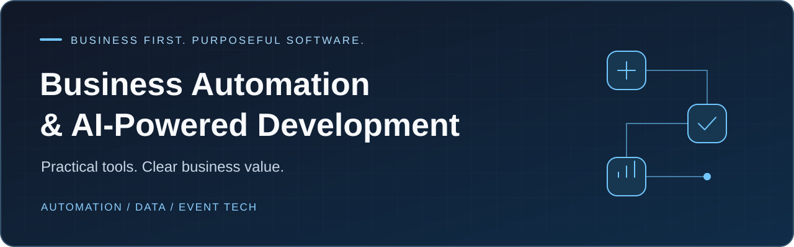

  

# Pavel Bugaev | Business Automation & AI-Powered Development

Turning business challenges into practical digital tools through AI-assisted development, data analytics and automation.

**Focus:** small business workflows, marketing operations and event technology.  
**Availability:** open to discussing freelance projects.

## About me

My background spans project management, marketing, events, MICE (meetings, incentives, conferences and exhibitions), and international projects. I have managed projects with budgets of up to **RUB 34 million** and am currently pursuing a master's degree in **Data Analytics and Artificial Intelligence**.

That experience helps me connect software requirements to everyday business needs: clear processes, reliable information, manageable budgets and less repetitive work.

I am building my programming skills and use **OpenAI Codex and other AI tools** to support development. My focus is on practical, clearly scoped solutions, with testing and documentation built into the delivery process.

## What I build

Areas I am developing toward for small and medium-sized businesses:

| Area | Business use |
| --- | --- |
| Business Process Automation | Reduce repetitive steps and manual handoffs. |
| Excel & CSV Automation | Clean, combine and prepare spreadsheets for everyday work. |
| Data Processing & Analytics | Turn scattered data into useful summaries and reports. |
| Telegram Bots | Support booking, request intake and notifications. |
| Document Generation | Create proposals, documents and reports from templates. |
| Web Applications | Give teams simple interfaces for their workflows. |
| Market Intelligence | Organize public market and pricing data from permitted sources. |
| Event Management Tools | Bring budgets, participants and contractors into one workflow. |
| AI-Powered Business Solutions | Apply AI to clearly defined tasks with human review. |

## Technology stack

**Tools I use or am learning** — this is a working toolkit, not a claim of expert proficiency.

| | Focus | Tools |
| :---: | --- | --- |
| `>_` | Development & AI assistance | Python · OpenAI Codex |
| `▦` | Data & spreadsheets | Pandas · OpenPyXL · SQLite |
| `</>` | Interfaces & web | Streamlit · HTML · CSS · JavaScript |
| `↗` | Version control & collaboration | Git · GitHub |

## Portfolio roadmap

**All five projects below are planned.** They are not completed products or client case studies. Demos and repository links will be added as development progresses.

| Project | Intended outcome | Status |
| --- | --- | --- |
| **Excel Assistant** | Process, merge and clean Excel and CSV files. | Planned |
| **Document Generator** | Generate documents, proposals and reports from templates. | Planned |
| **Price Monitor** | Monitor prices and analyze public data from permitted sources. | Planned |
| **Telegram Booking Bot** | Manage customer bookings, requests and administrator notifications. | Planned |
| **Event Dashboard** | Organize events, budgets, participants, contractors and analytics. | Planned |

## How I work

My intended workflow for commercial projects:

1. **Understand the business requirements.** Identify the users, current process, constraints and acceptance criteria.
2. **Design the solution.** Agree on a manageable scope, inputs, outputs and delivery milestones.
3. **Develop with AI assistance.** Use Codex and other tools while reviewing the implementation against requirements.
4. **Test and check quality.** Verify core workflows, edge cases and error handling with representative data.
5. **Document the result.** Provide setup instructions, usage guidance and known limitations.
6. **Deliver and support.** Walk through the solution and agree on the scope of ongoing support.

## Professional background

**Project Management · Marketing · Event Management · MICE · International Projects**

Business experience informs how I approach requirements, stakeholder communication, budgets and delivery. My current master's studies add a developing foundation in **Data Analytics & AI**.

## Languages

**Russian — Native** · **English — C1**

## Contact & collaboration

Open to discussing freelance work in business automation, data workflows and event technology.

If you found this profile through a freelance platform, please contact me there. A useful project brief includes the current workflow, the desired result, example inputs with sensitive data removed, and your timeline.

## По-русски

Меня зовут **Павел Бугаев**.

Моё направление — **автоматизация бизнес-процессов и разработка с помощью ИИ** для малого и среднего бизнеса, маркетинга и event-индустрии.

У меня есть опыт управления проектами с бюджетами до **34 млн рублей**, работы в маркетинге, MICE и международных проектах. Сейчас я учусь в магистратуре по направлению анализа данных и искусственного интеллекта, развиваю навыки программирования и использую OpenAI Codex и другие ИИ-инструменты.

Основные направления: обработка Excel и CSV, аналитика, генерация документов, Telegram-боты, веб-инструменты и решения для управления мероприятиями. Пять проектов в портфолио пока **запланированы**; готовых продуктов и клиентских кейсов в этом списке нет.

Открыт к обсуждению фриланс-проектов с понятными требованиями и согласованным объёмом работ. Если вы пришли с фриланс-площадки, связаться со мной можно там. Русский — родной, английский — C1.

